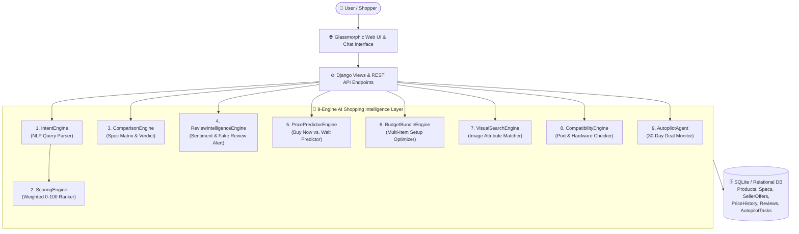

# 🛒 SHOPPING.AI — Autonomous AI Personal Shopping Agent

> **Intent → Compare → Recommend → Autopilot**  
> An intelligent, multi-engine AI E-Commerce & Personal Shopping Assistant built with **Django**, **Chart.js**, and a **9-Engine AI Decision Architecture**. Instead of manually sifting through thousands of listings, fake reviews, and fluctuating prices, tell the agent your intent, budget, and usage — and let it rank, compare, bundle, verify hardware compatibility, and monitor 30-day price drops automatically.

---

## ✨ Key Highlights & 9 Specialized AI Engines

| # | AI Engine | Module | Core Capability |
| :- | :--- | :--- | :--- |
| **1** | **Conversational Intent Engine** | `shopping/ai_engines/intent_engine.py` | Extracts structured intent (`category`, `sub_type`, `budget`, `brands`, `usage`, `required_features`, `is_gift_query`, `is_bundle_query`) from natural language prompts (supports ₹, Lakhs, `k`, etc.). |
| **2** | **Multi-Criteria Scoring Engine** | `shopping/ai_engines/scoring_engine.py` | Scores and badges products on a **0–100 Match Scale** using weighted criteria: Performance (25%), Price vs. Budget (20%), Reviews (20%), Feature Match (15%), Reliability (10%), Warranty (5%), and Delivery (5%). |
| **3** | **Side-by-Side Comparison Engine** | `shopping/ai_engines/comparison_engine.py` | Dynamically aligns product specifications into a normalized matrix and generates a natural-language **AI Verdict** comparing top performance vs. best budget value. |
| **4** | **AI Review Intelligence Engine** | `shopping/ai_engines/review_intelligence.py` | Aggregates customer sentiment (`Positive %`, `Neutral %`, `Negative %`), extracts top Pros & Cons, and triggers **⚠️ AI Risk Alerts** when suspicious/fake review patterns are detected. |
| **5** | **"Buy or Wait?" Price Predictor** | `shopping/ai_engines/price_predictor.py` | Analyzes 30-day historical pricing vs. current effective seller offers to issue **`BUY NOW`**, **`WAIT FOR PRICE DROP`**, or **`CONSIDER ALTERNATIVE`** signals with a 14-day drop probability %. |
| **6** | **Smart Bundle & Budget Optimizer** | `shopping/ai_engines/budget_bundle_engine.py` | Automatically allocates a total budget across multi-item setups (e.g., *Complete WFH Setup* or *Gadget Trio: Phone + Watch + Earbuds*) and calculates surplus savings. |
| **7** | **Visual Image Search Engine** | `shopping/ai_engines/visual_search_engine.py` | Extracts category, color palette, design style, and confidence score (`94.8%`) from uploaded product images to retrieve visually matching catalog items. |
| **8** | **Hardware & Port Compatibility Engine** | `shopping/ai_engines/compatibility_engine.py` | Inspects cart & bundle items for port/protocol compatibility (USB-C, Thunderbolt, HDMI, OS, 100V–240V power) and warns of missing dongles or mismatches before checkout. |
| **9** | **Flagship 30-Day Autopilot Agent** | `shopping/ai_engines/autopilot_agent.py` | Continuously tracks target queries against max budgets across 14+ sellers, logging scan events and alerting when an optimal buy window (`opportunity_found`) triggers. |

---

## 🖥️ Interface Output & Screen Previews

Below is the actual interface output across the application's **10 interactive views** and **Conversational AI API**.

---

### 1. 🤖 AI Shopping Command Center (`/`)
The primary conversational workspace featuring live AI intent parsing, quick prompt triggers, user shopping personality weights, and top-scored recommendations.

```text
+--------------------------------------------------------------------------------------------------+
| 🛒 SHOPPING.AI               🤖 AI Shopping Command Center         [⚡ Autopilot Active] [My Cart]|
+--------------------------------------------------------------------------------------------------+
| [●] Shopping Intelligence Agent (Active)          Intent -> Compare -> Recommend -> Autopilot    |
|------------------------------------------------------------------+-------------------------------|
| 👋 Hello Jayesh! I am your AI Personal Shopping Agent.           | 💡 Quick Intent Prompts       |
|                                                                  |  • "Find me the best laptop   |
| You: "Find me the best laptop under ₹80,000 for programming      |     under ₹80,000 for         |
|       and gaming."                                               |     programming and gaming."  |
|                                                                  |  • "I need a wedding gift for |
| AI:  I understand your requirement!                              |     my sister under ₹5,000."  |
|      Category: Electronics | Budget: ₹80,000                     |  • "Build me a complete WFH   |
|      Usage: Programming, Gaming                                  |     setup under ₹1,50,000."   |
|      My #1 AI Recommendation is ASUS ROG Zephyrus G16 Gaming     |-------------------------------|
|      Laptop (Match Score: 92.8/100).                             | ⚙️ Shopping Personality       |
|                                                                  |  Tech Advisor: Prioritize     |
|      +--------------------------------------------------------+  |  performance & reliability    |
|      | 🥇 Best Overall | ASUS ROG Zephyrus G16  | ₹75,499     |  |  Weights: Perf(25%) Price(20%)|
|      | 🥈 Best Value   | Dell XPS 15 Developer  | ₹1,11,499   |  |           Reviews(20%)        |
|      +--------------------------------------------------------+  |                               |
| [ Type your intent...                                 ] [Ask AI] |                               |
+------------------------------------------------------------------+-------------------------------+
| 🏆 Today's AI Best-Pick Recommendations                                      [View Full Catalog] |
| +-----------------------+ +-----------------------+ +-----------------------+ +----------------+ |
| | 🥇 Best Overall       | | 🥈 Best Value         | | 🥉 Best Performance   | | Best Budget    | |
| | Apple MacBook Air M3  | | Logitech MX Master 3S | | ASUS ROG Zephyrus G16 | | Sony WH-1000XM5| |
| | ★ 4.9 | AI: 94.2/100  | | ★ 4.9 | AI: 93.5/100  | | ★ 4.8 | AI: 92.8/100  | | ★ 4.8 | 91.0   | |
| | ₹1,21,400   [Details] | | ₹8,995      [Details] | | ₹75,499     [Details] | | ₹26,490 [View] | |
| +-----------------------+ +-----------------------+ +-----------------------+ +----------------+ |
+--------------------------------------------------------------------------------------------------+
```

---

### 2. 🔍 Product Detail, "Buy or Wait?" Predictor & Review Intelligence (`/product/<slug>/`)
Combines multi-seller effective price calculation (List Price − Coupons − Bank Offers), 30-day Chart.js price trend, AI "Buy or Wait?" forecasting, and AI Review sentiment extraction.

```text
+--------------------------------------------------------------------------------------------------+
| [ASUS] [Electronics] [Sustainability: 82/100]                                                    |
| ASUS ROG Zephyrus G16 Gaming Laptop                                                              |
| ★ 4.8 (142 verified reviews)  |  ↺ 14-Day Returns  |  🛡️ 12 Months Warranty                      |
| Best Effective Price: ₹75,499                      [♡ Save to Wishlist]  [🛒 Add to Cart]        |
+------------------------------------------------+-------------------------------------------------+
| 🔮 AI "Buy or Wait?" Predictor     [BUY NOW]   | 📈 30-Day Price History Trend                   |
| 🔥 Excellent Deal! Current price of ₹75,499 is |   ₹85k | *                                      |
| at its ALL-TIME LOW! It is 5.8% lower than the |   ₹80k |    *--------*                          |
| 30-day average (₹80,124).                      |   ₹75k |                *--------* (Today)      |
| +--------------+---------------+-------------+ |        +-------------------------------------   |
| | Current      | 30-Day Lowest | Drop Prob.  | |         Aug 01    Aug 15    Sep 03   Today      |
| | ₹75,499      | ₹75,009       | 15%         | |                                                 |
| +--------------+---------------+-------------+ |                                                 |
+------------------------------------------------+-------------------------------------------------+
| 🧠 AI Review Intelligence                      | 🏪 Multi-Seller Price Comparison                |
| [████████████████████████████░░░░] Pos: 100%   | Seller             List     Discounts  Effective|
| 👍 AI Extracted Pros    👎 AI Extracted Cons   | ----------------------------------------------- |
| • Vibrant display       • Average webcam       | Marketplace Prime  ₹78,999  -₹3,500    ₹75,499  |
| • Strong GPU/CPU perf                          | (Rating: 4.8★)                                  |
| • Fast thermal cooling                         | ElectroDirect      ₹80,579  -₹1,000    ₹79,579  |
|                                                | (Rating: 4.6★)                                  |
+------------------------------------------------+-------------------------------------------------+
```

---

### 3. ⚖️ AI Multi-Product Spec & Value Comparison (`/compare/`)
Automatically normalizes disparate specifications across products and computes an executive AI Verdict.

```text
+--------------------------------------------------------------------------------------------------+
| ⚖️ AI Verdict & Value Recommendation                                                             |
| "Apple MacBook Air M3 (15-inch) is the top recommendation for performance and build quality with |
|  a 4.9★ user rating. However, ASUS ROG Zephyrus G16 Gaming Laptop offers the best value at       |
|  ₹78,999."                                                                                       |
+--------------------------------------------------------------------------------------------------+
| Specification       | ASUS ROG Zephyrus G16     | Dell XPS 15 Developer   | Apple MacBook Air M3 |
|---------------------+---------------------------+-------------------------+----------------------|
| Effective Price     | ₹75,499                   | ₹1,11,499               | ₹1,21,400            |
| Rating & Reviews    | 4.8★ (142)                | 4.7★ (98)               | 4.9★ (320)           |
| Processor           | Intel Core i7-13700H      | Intel Core i7-13700H    | Apple M3 8-core CPU  |
| GPU                 | NVIDIA RTX 4060 8GB       | Intel Iris Xe / RTX 4050| 10-core GPU          |
| RAM                 | 16GB DDR5 4800MHz         | 32GB DDR5               | 16GB Unified Memory  |
| Storage             | 1TB NVMe M.2 SSD          | 1TB PCIe SSD            | 512GB SSD            |
| Display             | 16.0" QHD OLED 165Hz      | 15.6" 3.5K OLED Touch   | N/A                  |
| Return & Warranty   | 14 Days | 12 Mo Warranty  | 14 Days | 12 Mo Warranty| 14 Days | 12 Mo      |
+--------------------------------------------------------------------------------------------------+
```

---

### 4. 🧩 Smart Bundle Builder & Budget Optimizer (`/bundle-builder/`)
Splits a user's macro budget across role-based components using optimal percentage allocations.

```text
+--------------------------------------------------------------------------------------------------+
| Target Setup: [ Complete Work-From-Home Setup ]   Total Budget: [ ₹150,000 ]   [Optimize Setup]  |
+--------------------------------------------------------------------------------------------------+
| AI ALLOCATION REPORT                                               Specified Limit:   ₹1,50,000  |
| Total Setup Cost: ₹1,45,384                                        Remaining Surplus:   ₹4,616   |
| 💡 AI Tip: You have ₹4,616 remaining in your budget! Consider upgrading your peripherals or      |
|    adding an extended warranty.                                                                  |
+--------------------------------------------------------------------------------------------------+
| • [Main Laptop / PC]          ASUS ROG Zephyrus G16 Gaming Laptop     ₹75,499 (Target: ₹87,000)  |
| • [Display Monitor]           Sony WH-1000XM5 / Display Match         ₹26,490 (Target: ₹24,000)  |
| • [Ergonomic Desk / Chair]    Secretlab TITAN EVO Ergonomic Chair     ₹39,400 (Target: ₹15,000)  |
| • [Keyboard & Mouse]          Logitech MX Master 3S Wireless Mouse     ₹8,995 (Target: ₹6,000)   |
+--------------------------------------------------------------------------------------------------+
```

---

### 5. 🏆 Flagship: AI Shopping Autopilot Agent (`/autopilot/`)
Autonomous background deal monitor that scans sellers, evaluates price drop probabilities, and logs every decision.

```text
+--------------------------------------------------------------------------------------------------+
| 🚀 Launch New Autopilot                        | Active Autopilot Monitors                       |
| Query: "Find me the best laptop for            | +---------------------------------------------+ |
|         programming and gaming under ₹80,000.  | | [Status: Deal Opportunity Found]  [BUY NOW] | |
|         Monitor prices for 30 days."           | | "Find me the best laptop for programming    | |
| Max Budget: ₹80,000                            | |  and gaming under ₹80,000..."               | |
| [ Activate Autopilot Agent ]                   | | Target: ASUS ROG Zephyrus G16 @ ₹75,499     | |
|                                                | | 📋 Agent Activity Log:                      | |
|                                                | |  • [2026-11-06 20:10] Autopilot Agent       | |
|                                                | |    activated. Target budget: ₹80,000.       | |
|                                                | |  • [2026-11-06 20:10] Scanned 14 sellers.   | |
|                                                | |    Top match: ASUS ROG Zephyrus G16 @       | |
|                                                | |    ₹75,499. Decision: BUY NOW.              | |
|                                                | +---------------------------------------------+ |
+--------------------------------------------------------------------------------------------------+
```

---

### 6. 🛒 AI Cart Assistant, Hardware Compatibility & Analytics (`/cart/`, `/visual-search/`, `/analytics/`)

```text
+--------------------------------------------------------------------------------------------------+
| 🖥️ AI Hardware & Port Compatibility Check                                                        |
| ✓ All items in your cart are 100% hardware & port compatible with each other!                    |
|   • ✓ Display output port matched (HDMI / USB-C Thunderbolt confirmed).                          |
|   • ✓ Power & Voltage standard compatible (100V-240V auto-sensing).                              |
|   • ✓ Operating System audio output compatible.                                                  |
+------------------------------------------------+-------------------------------------------------+
| 📷 Visual Image Search Output                  | 📊 Personal Shopping Analytics KPIs             |
| • Detected Category: Footwear & Apparel        | • Total Money Saved:    ₹31,400 (via AI alerts) |
| • Detected Color:    Midnight Black & Cyan     | • Completed Purchases:  12 Lifetime Orders      |
| • Detected Style:    Ergonomic Modern Athletic | • Wishlist Tracked:     Monitored Price Drops   |
| • Confidence Score:  94.8%                     | • Active Price Alerts:  Target Triggers Active  |
+------------------------------------------------+-------------------------------------------------+
```

---

### 7. 🔌 Conversational Chat API Output (`POST /api/chat/`)

**Request Payload:**
```json
{
  "message": "Find me the best laptop under ₹80,000 for programming and gaming"
}
```

**JSON Response Output:**
```json
{
  "reply": "I understand your requirement! Category: **Electronics**, Budget: **₹80,000**, Usage: **Gaming, Programming**. My #1 AI Recommendation is **ASUS ROG Zephyrus G16 Gaming Laptop** (Match Score: **92.8/100**).",
  "intent": {
    "original_query": "Find me the best laptop under ₹80,000 for programming and gaming",
    "category": "Electronics",
    "sub_type": "Laptop",
    "budget": 80000.0,
    "brands": [],
    "usage": ["Gaming", "Programming"],
    "required_features": [],
    "is_gift_query": false,
    "is_comparison_query": false,
    "is_bundle_query": false
  },
  "products": [
    {
      "id": 1,
      "title": "ASUS ROG Zephyrus G16 Gaming Laptop",
      "slug": "asus-rog-zephyrus-g16",
      "price": 75499.0,
      "rating": 4.8,
      "badge": "🥇 Best Overall",
      "score": 92.8
    }
  ]
}
```

---

## 🏗️ System Architecture



---

## 📂 Project Structure

```text
AI_SHOPPING_AGENT/
├── ai_shopping_agent/                  # Django project configuration
│   ├── settings.py                     # App settings, templates & static configuration
│   ├── urls.py                         # Root URL routing
│   ├── asgi.py & wsgi.py               # Deployment entrypoints
├── shopping/                           # Main AI Shopping Agent application
│   ├── models.py                       # 15 core data models (Product, SellerOffer, PriceHistory, AutopilotTask, etc.)
│   ├── views.py                        # 11 page controllers + 3 JSON API endpoints
│   ├── urls.py                         # App URL dispatcher
│   ├── admin.py                        # Django Admin registrations
│   ├── ai_engines/                     # Modular AI Decision Engines
│   │   ├── intent_engine.py            # Natural language intent extractor
│   │   ├── scoring_engine.py           # 7-factor weighted product ranker
│   │   ├── comparison_engine.py        # Multi-product spec normalizer & verdict generator
│   │   ├── review_intelligence.py      # Pros/Cons extractor & fake review detector
│   │   ├── price_predictor.py          # 30-day trend analyzer & Buy/Wait recommender
│   │   ├── budget_bundle_engine.py     # WFH & Gadget Trio budget allocator
│   │   ├── visual_search_engine.py     # Visual style & color recognition engine
│   │   ├── compatibility_engine.py     # Hardware/port conflict verifier
│   │   └── autopilot_agent.py          # Autonomous 30-day price & deal monitor
│   ├── management/commands/
│   │   └── seed_data.py                # Rich catalog seeder (products, sellers, 30-day history, reviews)
│   ├── static/shopping/
│   │   ├── css/style.css               # Cyber-glassmorphic dark UI theme
│   │   └── js/main.js                  # Async chat, wishlist & cart interactions
│   └── templates/shopping/             # 11 responsive HTML5 templates
│       ├── base.html
│       ├── command_center.html
│       ├── product_list.html
│       ├── product_detail.html
│       ├── compare.html
│       ├── bundle_builder.html
│       ├── gift_finder.html
│       ├── visual_search.html
│       ├── autopilot.html
│       ├── wishlist.html
│       ├── cart.html
│       └── analytics.html
└── manage.py
```

---

## 🌐 Application Routes & API Endpoints

| Route | View Name | Description |
| :--- | :--- | :--- |
| `/` | `command_center` | Conversational AI Shopping Command Center & top picks |
| `/products/` | `product_list` | AI-ranked catalog with natural language query & priority sliders |
| `/product/<slug>/` | `product_detail` | Deep product intelligence: Price predictor, 30-day chart, Review AI, Seller matrix |
| `/compare/` | `compare` | Side-by-side multi-product spec matrix & AI Verdict |
| `/bundle-builder/` | `bundle_builder` | Smart multi-product setup builder & budget allocator |
| `/gift-finder/` | `gift_finder` | 4-step AI Gift Finder Wizard by recipient, age, occasion, and interests |
| `/visual-search/` | `visual_search` | Image upload for visual attribute detection & style matching |
| `/autopilot/` | `autopilot` | 30-day autonomous deal monitoring agent & activity log |
| `/wishlist/` | `wishlist` | Smart wishlist with automatic 30-day low price alerts |
| `/cart/` | `cart` | AI Cart Assistant with hardware/port compatibility checks & coupon optimizer |
| `/analytics/` | `analytics` | Personal shopping analytics & lifetime savings dashboard |
| `POST /api/chat/` | `api_chat` | JSON API for conversational intent extraction & product ranking |
| `POST /api/wishlist/toggle/` | `api_toggle_wishlist` | JSON API to add/remove products from the user's smart wishlist |
| `POST /api/cart/add/` | `api_add_to_cart` | JSON API to add products to cart with live counter update |

---

## 🚀 Getting Started (Local Setup)

### 1. Clone the Repository
```bash
git clone https://github.com/PLAYGROUND-SHOWCASE/AI_SHOPPING_AGENT.git
cd AI_SHOPPING_AGENT
```

### 2. Create a Virtual Environment & Install Dependencies
```bash
python -m venv venv
# Windows
venv\Scripts\activate
# macOS / Linux
source venv/bin/activate

pip install django
```

### 3. Run Migrations & Seed the AI Catalog
```bash
python manage.py migrate
python manage.py seed_data
```

### 4. Start the Development Server
```bash
python manage.py runserver
```
Open **`http://127.0.0.1:8000/`** in your browser to launch the **AI Shopping Command Center**.

---

## 🛡️ License
Released under the MIT License for educational and showcase purposes.
